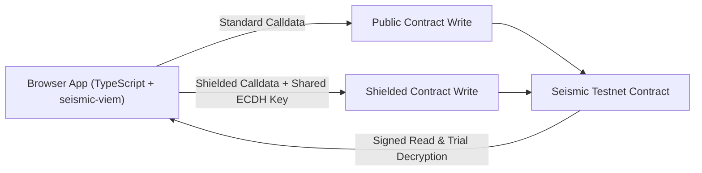

# 🛡️ Seismic Privacy Playground

> Open-source developer sandbox for **Seismic Testnet** built with Vite, TypeScript, Viem, and `seismic-viem` — exploring shielded transactions, encrypted state reads, and client-side payload decryption.

---

## Overview

While architecting [Rift CLMM](https://github.com/Shahrokh20000/rift-clmm) for the Seismic ecosystem, this sandbox served as a practical developer reference for integrating [`seismic-viem`](https://www.npmjs.com/package/seismic-viem) into browser-based dApps — demonstrating public vs. shielded writes, keypair management, and client-side trial decryption without external backend dependencies.



---

## Features

- **Dual-State Routing:** Toggle cleanly between public on-chain calls and shielded `seismic-viem` transactions.
- **Client-Side Encrypted Payload Decryption:** Derive shared secrets (`secp256k1`) and decrypt private transaction history directly in browser memory.
- **Session Keypair Initialization:** Automated keypair check and contract public-key initialization workflow.
- **Interactive Portfolio View:** Glassmorphic TypeScript UI comparing public and encrypted interaction histories side-by-side.

---

## Tech Stack

- **Frontend:** TypeScript, Vite, HTML5, CSS3
- **Web3 & Cryptography:** [`seismic-viem`](https://github.com/SeismicSystems/seismic-viem), [`viem`](https://viem.sh/), `@noble/ciphers`, `@noble/curves`
- **Network:** Seismic Testnet

---

## Getting Started

### Prerequisites

- Node.js (`v18+`) and `npm`

### Local Development

1. Clone the repository:
   ```bash
   git clone https://github.com/Shahrokh20000/seismic-demo-dev.git
   cd seismic-demo-dev
   ```

2. Install dependencies:
   ```bash
   npm install
   ```

3. Start the Vite development server:
   ```bash
   npm run dev
   ```

4. Build for production:
   ```bash
   npm run build
   ```

---

## Faucet & Testing

Testnet gas tokens are required to submit on-chain messages on Seismic Testnet and can be requested via the official [Seismic Faucet](https://faucet.seismictest.net/).

---

## License

Distributed under the [MIT License](LICENSE).
